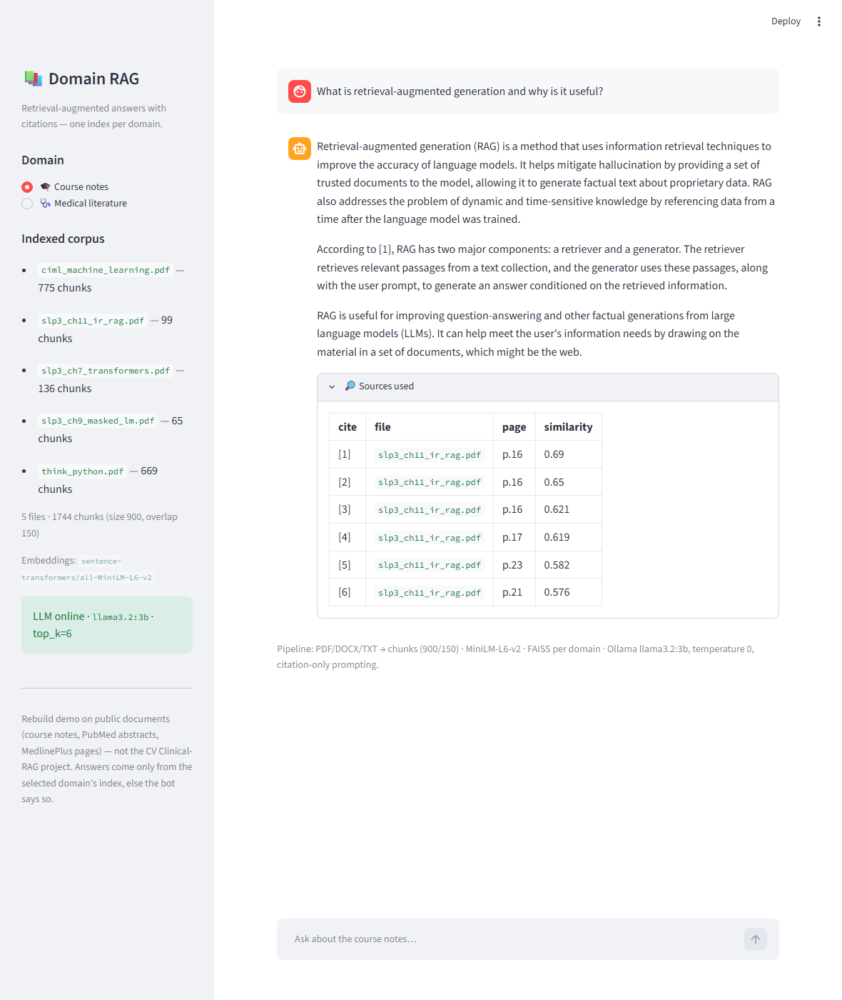

# Course & Medical RAG Chatbot 🎓🩺

A small **retrieval-augmented generation** chatbot that answers student and
clinical questions **about the documents it was given**, with citations, and
admits when the answer is not in the material.

Two domain modules, one engine (each domain = its own FAISS index, askable from
the sidebar):

- **🎓 Course notes** — ML + Python + NLP/RAG course texts
- **🩺 Medical literature** — PubMed abstracts + NIH MedlinePlus patient pages

Built on public documents (downloaded on first run) and Ollama running locally,
so the whole demo works **fully offline** once assets are cached.

> 📝 Scoping note: this is a **rebuild demo** on public data, built quickly for
> interviews — same RAG family as the Clinical RAG system referenced on my CV,
> but *not* that project, and the numbers here are from this repo's own little
> demo eval set.



## What it does

| Stage | Where | Detail |
|---|---|---|
| Load | `src/loaders.py` | PDF / DOCX / TXT → page-level text (page numbers preserved) |
| Chunk | `src/ingest.py` | `RecursiveCharacterTextSplitter`, 900 chars, 150 overlap, per-page |
| Embed | `sentence-transformers` | `all-MiniLM-L6-v2`, L2-normalised |
| Index | FAISS | `IndexFlatIP` (exact search = cosine similarity) |
| Retrieve | `src/retrieve.py` | top-k=6, similarity metadata kept |
| Gate | `src/chat.py` | similarity < 0.30 → honest "not found", no LLM call |
| Answer | `src/answer.py` | Ollama `llama3.2:3b`, temperature 0, context-only prompt with `[n]` citations |
| UI | `app.py` | Streamlit: domain switch, chat, sources table (file, page, similarity) |

## Quickstart

```bash
# 1) environment (the venv lives outside the repo in these commands)
python -m venv .venv
.venv\Scripts\activate            # Windows; "source .venv/bin/activate" on Linux/macOS
pip install -r requirements.txt

# 2) install Ollama (https://ollama.com) and pull a small model
ollama pull llama3.2:3b

# 3) download the public course corpus, then build the index (~2 min on CPU)
bash scripts/download_corpus.sh
# optional second domain (medical): PubMed abstracts + MedlinePlus pages
python scripts/download_medical_corpus.py

# 4) build one FAISS index per domain (~2-3 min on CPU)
python -m src.ingest

# 5) warm the LLM once so the first real answer isn't slow (~10 s)
ollama run llama3.2:3b "Say OK"   # keeps the model resident (app keeps_alive 30 min)

# 6) run the app
streamlit run app.py
```

Ready for questions in the chat box below.

## The corpus (all public, free to use for study)

| File | Source | License/attribution |
|---|---|---|
| `ciml_machine_learning.pdf` | *A Course in Machine Learning* v0.99, Hal Daumé III ([ciml.info](https://ciml.info)) | free online edition, © author |
| `think_python.pdf` | *Think Python* 2e, Allen B. Downey ([greenteapress.com](https://greenteapress.com/wp/think-python-2e/)) | CC BY-NC |
| `slp3_ch7_transformers.pdf`, `slp3_ch9_masked_lm.pdf`, `slp3_ch11_ir_rag.pdf` | *Speech and Language Processing* 3rd ed. draft chapters 7/9/11, Jurafsky & Martin ([web.stanford.edu/~jurafsky/slp3](https://web.stanford.edu/~jurafsky/slp3/)) | free draft for coursework |

### Medical corpus (second domain — all public / public-domain)

| Type | What | Source |
|---|---|---|
| ~20 abstracts | semaglutide (STEP trials), SGLT2 inhibitors in HFpEF, metformin, inhaler technique | [NCBI E-utilities](https://www.ncbi.nlm.nih.gov/books/NBK25499/) (title/authors/abstract only, PMID kept) |
| 4 patient pages | diabetes, hypertension, asthma, obesity | [NIH MedlinePlus](https://medlineplus.gov/) (US Gov public domain) |

Fetched by `scripts/download_medical_corpus.py` (no login, no credentials — never MIMIC-IV).

## Eval — 30-question retrieval demo set (hand-written, this repo only)

`eval/qa_pairs.csv` holds 30 questions I wrote against the corpora — 20 on course
notes (file + page verified by hand), 10 on the medical domain — each with an
expected source. `python -m eval.run_eval --no-llm` measures how often the right
chunk is retrieved (deterministic, model-free):

| scope | file hit rate | page hit rate |
|---|---|---|
| **overall (30 Q)** | **30/30 (100%)** | — |
| 🎓 course (20 Q) | 20/20 (100%) | 15/20 (75%) |
| 🩺 medical (10 Q) | 10/10 (100%) | not scored (whole-file docs) |

- **File-level** is the primary metric; **page-level** is the strict course-only
  version — the exact page must be among the top-k retrieved chunks. The 5
  page-misses are cases where the answer text spans adjacent pages and retrieval
  keeps the neighbour.
- `k=6` over `k=4`: better recall for definitions (65% → 75% on pages), cost is
  a slightly longer prompt. I chose 6 after measuring both.
- The similarity gate (0.30) came from a measured gap: in-corpus questions score
  ≥ ~0.44, out-of-corpus probes ~0.19-0.21.

Run eval with answers: `python -m eval.run_eval` (also spot-checks 5 answers through the LLM).

## Offline / fallback-demo mode

Once `data/raw/`, `vectorstore/`, the MiniLM model (HF cache) and the Ollama model
are on disk, everything runs with zero network. To prove it:

```bash
export HF_HUB_OFFLINE=1
streamlit run app.py
```

If the venue WiFi is bad, `eval/eval_results.md`, the screenshots in `docs/` and a
short screen recording are committed fallbacks.

## Design notes (interview talking points)

- **RAG over fine-tuning**: the corpus changes per student; fine-tuning would bake
  a fixed dataset into weights and still hallucinate. RAG keeps knowledge inspectable
  (you can see exactly which chunk an answer came from), updatable by re-running
  `python -m src.ingest`, and auditable (page citations).
- **One engine, per-domain indexes**: `data/raw/<domain>/` folders each build a
  separate FAISS index, so course questions never cross-search PubMed abstracts
  and vice versa. Adding a domain = drop a folder, run ingest, no code changes.
- **Hallucination control**: prompt instructs to answer *only* from numbered
  context passages and to refuse otherwise; temperature 0; a measured similarity
  gate cuts off-corpus questions before the LLM is ever called. Small local
  models can be *over*-conservative (seen live: the 3B refused a "side effects"
  question the passages clearly answered) — the tradeoff of refusing vs guessing
  is deliberate.
- **Chunk size 900 / overlap 150**: ~1-2 paragraphs per chunk — large enough to
  keep a definition (usually 3-5 sentences) in one piece, small enough that 6
  chunks still fit well under the 3B model's context window. Overlap keeps
  sentences that straddle boundaries readable in both chunks.
- **LangChain + direct FAISS**: LangChain for splitting and chat orchestration;
  embeddings + FAISS called directly so page-level metadata stays in my control
  (wrappers made "which page?" harder to get right for this use case).
- **Local vs hosted LLM**: local (Ollama 3B) = no data leaves the laptop, no API
  bill, works offline; hosted = better answers, but demo-day depends on venue WiFi.
  This repo reads `OLLAMA_BASE_URL` so pointing it at a hosted endpoint later is a
  config change, not a code change.
- **Offline serving**: serve runs with `HF_HUB_OFFLINE=1` by default (embedder is
  cached) — no network calls anywhere in the request path.
- **What I'd improve next**: per-file retrieval filters inside a domain, embedding
  fine-tune on the domain, reranking (cross-encoder) before the LLM, streaming,
  and a bigger hosted model for the compare-local-vs-hosted chart.

## Project layout

```
app.py                  Streamlit UI (domain switch, chat, sources)
src/
  config.py             all knobs (env-overridable)
  loaders.py            PDF/DOCX/TXT -> pages
  ingest.py             chunk -> embed -> FAISS, one index per domain
  retrieve.py           search + metadata (domain-aware)
  answer.py             prompt + Ollama call
  chat.py               question -> answer pipeline (+ similarity gate)
eval/
  qa_pairs.csv          30 hand-written Q/A across both domains (rebuild demo set)
  run_eval.py           retrieval hit-rate report -> eval_results.md
  eval_results.md       latest measured results (committed)
scripts/
  download_corpus.sh    fetch public course PDFs + verify
  download_medical_corpus.py  fetch PubMed abstracts + MedlinePlus pages
  probe_retrieval.py    dev helper: where do questions land?
  take_screenshots.py   dev helper: automated screenshots + demo recording
docs/                   screenshots (+ fallback demo material)
Dockerfile, docker-compose.yml
```

## FAQ corner

- *"Why does the first answer take a while?"* — Ollama loads the 3B model on the
  first request. Warm it explicitly (`ollama run llama3.2:3b "Say OK"`) before a
  demo; the app then keeps it resident for 30 min between questions (`keep_alive`).
- *"Wrong page in a citation?"* — honest behavior: retrieval keeps the chunk on
  the neighbouring page; the sources panel is visible exactly for that.
- *"What if I ask something not in the notes?"* — it says it couldn't find it,
  and shows the (low) similarity scores for transparency.
- *"Medical advice?"* — no: answers cite abstracts/patient pages, are labeled as
  a demo, and the gate refuses anything outside the indexed documents.
- *"Why two screenshots of refusals in docs/?"* — they demonstrate the honest
  "not found" behavior on an off-corpus question (World Cup) and the
  conservative-but-safe failure mode of a 3B model — both are things I talk
  about rather than hide.
